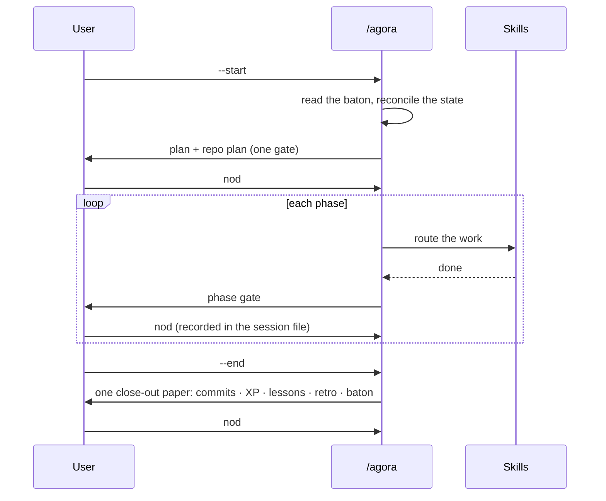

# agora-method

[](https://github.com/riccardito/agora-method/actions/workflows/ci.yml)

[](LICENSE)

**A working method for building software with an AI agent — sessions, skills, rules and the checks that hold them — extracted from six months of daily use.**

## The problem

An AI coding agent forgets everything between conversations. The usual fix is a growing prompt file, and it fails the same way every time: rules pile up, contradict each other, and nobody notices which ones stopped being followed. The hard part is not writing instructions — it is keeping a few hundred of them true, current and enforced while the project moves.

## The result

This repository is the method layer of a private clinical information system, built by one developer and an agent over 402 recorded sessions. It ships the real operating files, not a summary of them.

| Measure | Value |
|---|---|
| Operating corpus | **8 skills + 9 policies**, 6 370 lines, in use since May 2026 |
| Domain share of the corpus | **0.0 %** (the raw copy: 1.06 %, 81 lines naming the parent product's domain) |
| Checks | **6**, each a script with an exit code, all green in CI |
| Clone to green demo | **CLONE_TO_GREEN** on a fresh machine (target: under 10 minutes) |
| Tests | 41, 93 % line coverage |

The domain share is measured by a classifier that sorts every line into *agora*, *domain*, *layout*, *stack* or *neutral*. The publish rule is zero domain lines, and CI enforces it.

## Quickstart

```bash
git clone https://github.com/riccardito/agora-method && cd agora-method
python -m venv .venv && . .venv/bin/activate   # Windows: .venv\Scripts\activate
make install && make demo
```

`make demo` builds a throwaway child project, runs one session from start to end — read the last baton, open, two phase gates with the user's nod, close-out paper — and then runs all six checks over the result:

```
== --start
   from 2026-01-05-units-kickoff:
     - Goal: Length conversions, criterion 2 next -- the four imperial units
== gate
   Phase 1 ticked -- the nod 'go' is written beside the box, in one act
== --end
   close-out paper written, status closed, INDEX re-rendered
[agora_checks] 6/6 green
[demo] green in 0.8 s
```

## How it is built

> **A mechanism the system calls survives; a mechanism a human must remember does not.**


A session is opened and closed by the orchestrator. Between the two, work routes to skills; skills apply policies; the state files remember what happened. The arrow back up is the point of the design: when a session teaches something, `/learn` classifies the lesson as **mechanism**, **prose** or **judgment**, and a mechanism lesson becomes a check rather than another paragraph.



## The six checks

| Check | What it holds |
|---|---|
| `frontmatter` | skill and policy files parse as strict YAML; each level carries the fields and sections it claims |
| `record-consistency` | a fact that lives in two files has one source; derived copies are generated or compared verbatim |
| `prose-mass` | a skill file does not grow by parking incidents beside its rules; a per-file baseline that only falls |
| `domain-share` | no line names the parent product's domain; product names are matched by hash, never written here |
| `links` | every relative link resolves — the check a corpus moved out of its parent needs most |
| `secrets` | no key, token or private key is committed |

Run them with `make check`. Each prints `[FAIL]` lines and one summary; the exit code is the verdict.

## Start your own child

1. Copy `.claude/`, `agora/`, `agora_checks/` and `CLAUDE.md` into your project.
2. Write your `CLAUDE.md` overview and your COMPASS: a Vision, a Mission, one Era, one Goal with success criteria.
3. Replace the domain vocabulary in `agora/domain-terms.yaml` with your parent's, if your corpus came from somewhere.
4. Open a Claude Code session and type `/agora --start`.

`examples/first-child/` is the smallest child that passes every check. [`docs/method.md`](docs/method.md) explains the parts.

## The planning vocabulary

Generated from [`agora/vocabulary.yaml`](agora/vocabulary.yaml) — edit the source, not this table.

<!-- rc:tier-table -->
| Tier | Granularity | Closes with |
|---|---|---|
| Vision → Mission | forever / multi-year | re-stated, never closed |
| **Era** | several Goals — a themed chapter | the `New Era` event |
| **Goal** | weeks–months | success criteria met → a Milestone |
| **Sub-goal** | hours–days | one conventional commit |
| **Session** | a work window | a two-way retro |
| **Milestone** *(an event, not a tier)* | when its Goals close | tag + push + CI-green (the Haleluja) |
| **Arc** *(a movement, not a tier)* | a named multi-session movement inside an Era — phases + a paper + a ledger Issue | the `Arc-close` event: its paper written, its ledger emptied — no tag of its own (its Goals fired their own Halelujas) |
| **North star** *(an orientation, not a tier)* | a named horizon for a topic / design line — never committed | never closed — orients decisions ("closer or farther?"); retired only by explicit ruling |
<!-- /rc:tier-table -->

## What I learned, and what is open

**Gates cost more than steps.** The close of a session once had eleven steps and five questions to the user. It felt heavy; the steps were not the cause. Collapsing five gates into one paper with one nod made it light without removing a single check.

**Prose rules decay; checks do not.** Many of the rules here were written down after the second time something broke. The ones that held were the ones that became a script. Several still exist only as prose — the corpus says so where it matters.

**A scanner you wrote is a claim.** The domain classifier was trusted only after it reproduced an earlier hand-made table within rounding, and after a planted term turned it red.

Open:

- The corpus names about fifty substrate commands of the parent project. They are described, not shipped; this repository ships the checks and five session writers. A full substrate for a child is the next piece of work.
- The skill files are long because they carry six months of corrections. The prose-mass ratchet keeps them from growing; making them shorter is a separate job.
- Coverage of the method by children: one example child exists. The first real one will find what the example cannot.

## Licence

MIT — see [LICENSE](LICENSE).
