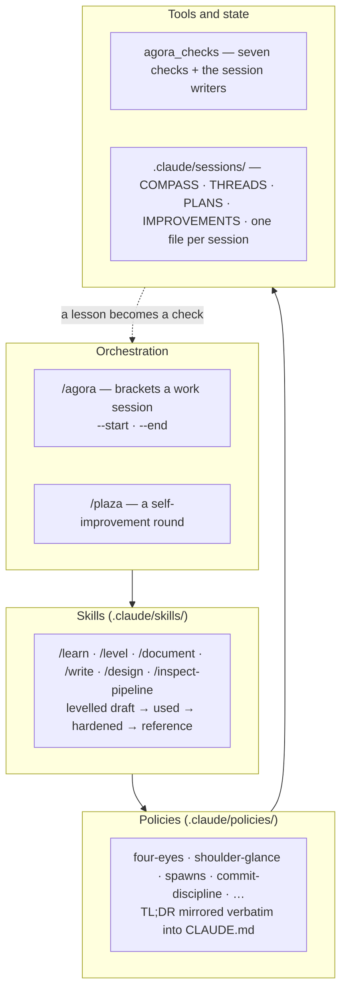
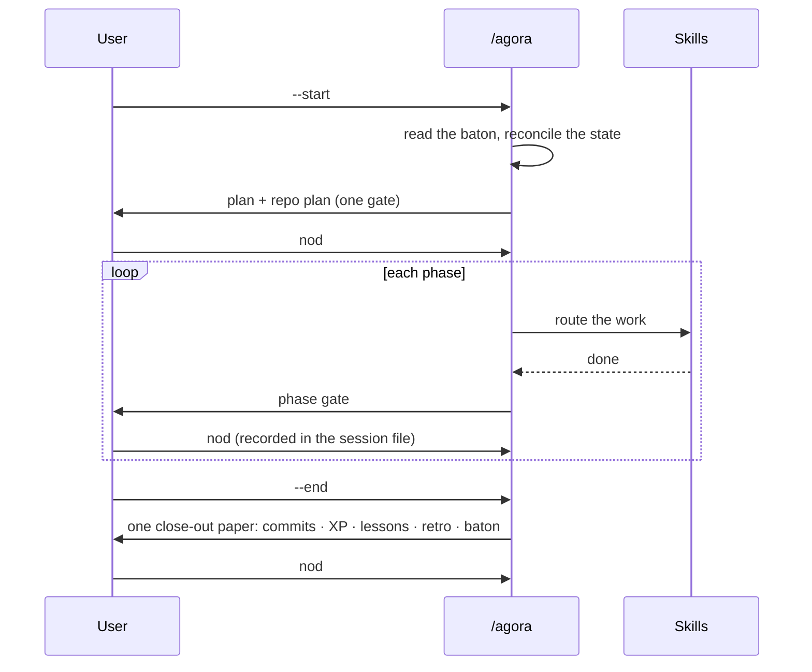

# agora-method

[](https://github.com/riccardito/agora-method/actions/workflows/ci.yml)

[](LICENSE)

**A working method for building software with an AI agent — sessions, skills, rules and the checks that hold them — extracted from six months of daily use.**

## What this is, and what you can do with it

The operating layer of an AI-assisted development pipeline, published as a template you can copy into your own project. It is plain files: instructions the agent reads (`.claude/`), state it keeps between sessions, and seven checks that fail the build when the files drift.

- **Start a project that works this way:** copy four folders, write a short COMPASS, type `/agora --start` in Claude Code.
- **See one session run:** `make demo` plays a whole session in a throwaway project and checks the result.
- **Borrow single pieces:** the four-eyes policy, the prose-mass ratchet, the record-consistency check and the domain-share check each work on their own.
- **Read how a method keeps itself honest:** every rule in the corpus carries the date and the story it was learned from.

## The problem

An AI coding agent forgets everything between conversations. The usual fix is a growing prompt file, and it fails the same way every time: rules pile up, contradict each other, and nobody notices which ones stopped being followed. The hard part is not writing instructions — it is keeping a few hundred of them true, current and enforced while the project moves.

## Why it matters

Where software is regulated — health, finance, public infrastructure — working with AI agents needs three things a prompt file cannot give: a trail of what was decided and why, a human approval at the points where it counts, and rules that cannot quietly be forgotten. This method supplies all three with files and checks, and it was built inside exactly such a domain.

## The result

This repository is the method layer of a private clinical information system, built by one developer and an agent over 402 recorded sessions. It ships the real operating files, not a summary of them.

| Measure | Value |
|---|---|
| Operating corpus | **8 skills + 9 policies**, 6 370 lines, in use since May 2026 |
| Domain share of the corpus | **0.0 %** (the raw copy: 1.06 %, 81 lines naming the parent product's domain) |
| Checks | **7**, each a script with an exit code, all green in CI |
| Clone to green demo | **17 s** on a fresh CI runner, install included (target: under 10 minutes) |
| Tests | 46, 93 % line coverage, CI fails under 90 % |

## Quickstart

```bash
git clone https://github.com/riccardito/agora-method && cd agora-method
python -m venv .venv && . .venv/bin/activate   # Windows: .venv\Scripts\activate
make install && make demo
```

`make demo` builds a throwaway child project, runs one session from start to end, and then runs all seven checks over the result:

```
== --start
   from 2026-01-05-units-kickoff:
     - Goal: Length conversions, criterion 2 next -- the four imperial units
== gate
   Phase 1 ticked -- the nod 'go' is written beside the box, in one act
== --end
   close-out paper written, status closed, INDEX re-rendered
[agora_checks] 7/7 green
[demo] green in 0.8 s
```

## Five words you will meet

| Word | Meaning |
|---|---|
| **session** | one work window, recorded as one file: intent, plan, log, close-out |
| **baton** | the short hand-off a session leaves for the next one; the next start reads it first |
| **gate** · **nod** | a point where the agent stops and proposes; the user's explicit "go" is the nod, and it is written down |
| **close-out paper** | everything a session ends with — commits, lessons, retrospective, baton — presented once, approved once |
| **four-eyes** | the rule behind gates: nothing irreversible without a second pair of eyes |

The rest of the vocabulary, including the planning tiers, is in [`docs/method.md`](docs/method.md).

## Read this in 10 minutes

1. [`docs/method.md`](docs/method.md) — the parts and how they connect (5 min)
2. [`.claude/policies/policy-four-eyes.md`](.claude/policies/policy-four-eyes.md) — one policy, start to end (2 min)
3. [`agora_checks/domain_share.py`](agora_checks/domain_share.py) — one check, 118 lines (2 min)
4. `make demo` — one session running (1 min)

The orchestrator skill, [`.claude/skills/agora/SKILL.md`](.claude/skills/agora/SKILL.md), is 3 300 lines of operating text and six months of corrections. Read it last, and only the section you need.

## How it is built

> **A mechanism the system calls survives; a mechanism a human must remember does not.**



A session is opened and closed by the orchestrator. Between the two, work routes to skills; skills apply policies; the state files remember what happened. The arrow back up is the point of the design: when a session teaches something, `/learn` classifies the lesson as **mechanism**, **prose** or **judgment**, and a mechanism lesson becomes a check rather than another paragraph.



## The seven checks

| Check | What it holds |
|---|---|
| `frontmatter` | skill and policy files parse as strict YAML; each level carries the fields and sections it claims |
| `record-consistency` | a fact that lives in two files has one source; derived copies are generated or compared verbatim |
| `prose-mass` | a skill file does not grow by parking incidents beside its rules; a per-file baseline that only falls |
| `domain-share` | no line names the parent product's domain; product names are matched by hash, never written here |
| `shipped-refs` | every command, skill, story and path the corpus names but this repository does not ship is counted; the count may only fall |
| `links` | every relative link resolves — the check a corpus moved out of its parent needs most |
| `secrets` | no key, token or private key is committed |

Run them with `make check`. Each prints `[FAIL]` lines and one summary; the exit code is the verdict.

`shipped-refs` is the newest. A reviewer pointed out that the skill files promise about fifty commands and a dozen skills that are not here. The method's answer is the method itself: the observation became a check, and [`docs/method.md`](docs/method.md#referenced-but-not-shipped) explains every kind of reference it counts.

## Start your own child

1. Copy `.claude/`, `agora/`, `agora_checks/` and `CLAUDE.md` into your project.
2. Write your `CLAUDE.md` overview and your COMPASS: a Vision, a Mission, one Era, one Goal with success criteria.
3. Replace the domain vocabulary in `agora/domain-terms.yaml` with your parent's, if your corpus came from somewhere.
4. Open a Claude Code session and type `/agora --start`.

`examples/first-child/` is the smallest child that passes every check.

## What I learned, and what is open

**Gates cost more than steps.** The close of a session once had eleven steps and five questions to the user. It felt heavy; the steps were not the cause. Collapsing five gates into one paper with one nod made it light without removing a single check.

**Prose rules decay; checks do not.** Many of the rules here were written down after the second time something broke. The ones that held were the ones that became a script. Several still exist only as prose — the corpus says so where it matters.

**A scanner you wrote is a claim.** The domain classifier was trusted only after it reproduced an earlier hand-made table within rounding, and after a planted term turned it red.

Open:

- The substrate the corpus describes — about fifty commands — is not shipped; `shipped-refs` counts every reference to it, and the count is meant to fall as the commands that matter are ported.
- The skill files are long because they carry six months of corrections. The prose-mass ratchet keeps them from growing; making them shorter is a separate job.
- One example child exists. The first real one will find what the example cannot.

## Author

Built by Riccard Nef, AI engineer in Swiss healthcare IT — [LinkedIn](https://www.linkedin.com/in/riccard-nef-62683511b/) · [*The Agora Method*](https://medium.com/@stillwaiting/the-agora-method-b62263bde400).

## Licence

MIT — see [LICENSE](LICENSE).
