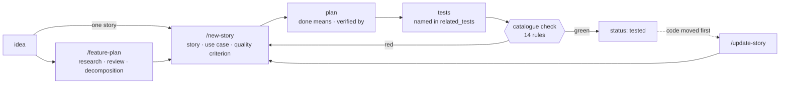
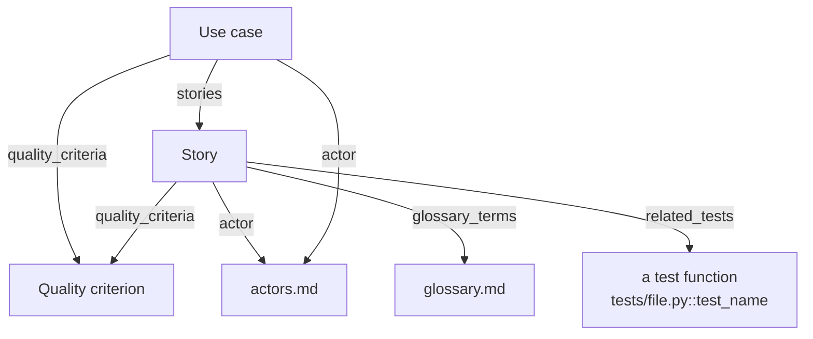

# Requirements engineering in the Agora method

A requirement here is a file, and a claim that it is done is a link to a test. This
page follows one requirement from the idea to the test that proves it. It covers the
four kinds of file in the catalogue, the three skills that write them, and the check
that refuses a catalogue whose parts no longer agree. The examples are real: the
catalogue under `requirements/` specifies the repository it lives in.

## The chain in one paragraph

An idea becomes a research paper when it is bigger than one story, and stories when it
is not. Each story names its actor, its acceptance criteria and the quality criteria it
serves. A use case groups the stories that serve one goal of one actor. A plan says
what "done" means and how it will be verified. The tests are named back in the story,
one per criterion. Then the `catalogue` check reads all of it and fails the build when
an id, a field, a reference or a claim of done does not hold. No step is new on its own — the difference is that the last link is enforced, so the chain cannot quietly break somewhere in the middle and stay broken until a reviewer asks where the test is.

## The catalogue: four kinds of file

Every entry is one Markdown file with YAML frontmatter on top and prose below. The
frontmatter is what the check reads; the prose is what a person reads. Templates for
each kind sit in `requirements/templates/`.

| Kind | Id | Lives in | Required fields |
|---|---|---|---|
| **Story** | `US-<AREA>-NNN` | `stories/<area>/` | actor, feature area, priority, status, source, related tests, quality criteria, glossary terms |
| **Use case** | `UC-<AREA>-NNN` | `use-cases/` | actor, status, the stories it groups |
| **Quality criterion** | `QC-<CAT>-NNN` | `quality-criteria/<category>/` | category, status, a measure with its threshold |
| **Vocabulary** | `###` headings | `actors.md`, `glossary.md` | — |

A story carries the familiar sentence: *As a requirements engineer, I want the
catalogue's stories, use cases and quality criteria checked against one another and
against the tests they name, so that every claim of done is backed by a test that
exists.* Under it come the acceptance criteria as checkboxes, each ending in the test
that proves it. Under those comes an `Origin` section — a requirement whose source is unknown cannot be argued with.

A quality criterion is a property with a number. `QC-POR-001` reads: a fresh clone
reaches a green demo in under ten minutes. Its `measure` field gives the method and
the threshold, and the measured value beside them — 17 seconds. The three categories in
use — reliability, maintainability, portability — are characteristics of ISO/IEC 25010.

Status runs through eight values, from `draft` to `tested`. Two of them carry weight in the check — `implemented` and `tested` are claims, and a claim must be backed.

The catalogue today holds 11 stories, 2 use cases and 3 quality criteria, all at
`tested`. Eight stories came with the corpus from the parent project and keep its ids;
three were born here and take the prefix `US-AM`.

## The pipeline: three skills write the catalogue

**`/feature-plan`** takes an idea too large for one story — a module, a workflow, a
compliance topic. It runs four phases. Discovery scans the codebase and, optionally,
the web. A critical review in hard mode tests the framing and proposes two or three
alternative shapes with their trade-offs. Decomposition breaks the chosen shape into
an umbrella use case and stories grouped by phase. Only then does it write files. Each
phase ends at a pause gate, so the user rules on the shape — which alternative, which stories, in which order — before a single story file exists. The research paper it produces is the record of *why* the stories look the way
they do.

**`/new-story`** writes one story from the template — after reading the conventions, never before. It picks the id prefix and folder, resolves the actor against `actors.md`, and
adds a use case when the feature is not trivial. A workflow comes too where actors hand
work to each other. A story that touches a screen also gets an ASCII wireframe and two
answers: where the surface lives, and how a user reaches it.

**`/update-story`** keeps the story true after the code moves. Its four input shapes
are text feedback, a design sync, a hand edit of the story file, and the one it runs
most: *reconcile-to-code*, where the code changed on purpose and the story has to
catch up. Without it, a catalogue drifts toward a description of what was once intended — accurate on the day it was written, and a little more wrong with every commit since.

Between the story and the test sits the plan. A planned session in
`.claude/sessions/PLANS.md` carries seven fields; two of them are the testing gate.
`done means` says what finished looks like. `verified by` names the command that will
show it. A plan without both cannot be loaded into an unattended run, because nobody
would be there to decide whether it worked.

## The gate: fourteen rules

`python -m agora_checks catalogue` reads every file and applies fourteen rules. Each
rule has an id, so a failure names the rule that caught it. They fall into four groups.

| Protects | Rules | What fails |
|---|---|---|
| **Identity** | C01–C03 | an id of the wrong shape; a file name that does not start with its id; one id used twice |
| **Shape** | C04, C05, C07, C08 | a missing field; a status, priority or source outside its list; a story without its user-story sentence or without one acceptance criterion |
| **Vocabulary** | C06, C12 | an actor that is not a heading of `actors.md`; a quality criterion, story or glossary term that does not exist |
| **The claim of done** | C09–C11, C13, C14 | a named test whose file or function is missing; a shipped story naming no test; a `tested` story with an unticked criterion; a shipped story no use case names; a use case still `draft` after all its stories shipped |

The last group is the point. Most catalogues check that entries are well formed. Few
check that what an entry *claims* is still true. C09 opens the named file and looks for
`def test_name(`. A test that was renamed or deleted makes the story's claim false, and the build says so the same day — not at the next audit, months later, when nobody remembers why the test went. C10 and C11 close the two easy ways around it: claiming
done with no test at all, and claiming tested while a criterion is still open.

C13 and C14 run the other direction, from story up to use case. A shipped story that
no use case names is a feature nobody can place in a user's goal. A use case left at
`draft` after every story under it shipped is a status nobody updated.

The rules are distilled from the parent project's catalogue lint, which runs 184 rules
over a larger catalogue. These fourteen are the ones a catalogue of any size needs.

## A worked trace: the check that specifies itself

`US-AM-003` is the story for the `catalogue` check. Its four acceptance criteria name
four tests in `tests/test_catalogue.py`:

- a well-formed catalogue passes;
- each of the fourteen rules fails on its own planted fault;
- a test reference must name a file *and* a function that exist;
- this repository's own catalogue passes.

The second test is parametrised over the fourteen rule ids. For each one it builds a
catalogue that is valid except for one planted fault, and asserts that exactly that
rule reds. A rule that cannot fail is not a rule — and this test is how each of the fourteen shows it can.

The fourth test closes the loop. The story describing the check is itself an entry the
check reads, so if `US-AM-003` dropped one of its named tests, C09 would fail on the
story that specifies C09. `UC-AM-002` (*keep the corpus true*) names the story;
`QC-REL-001` (*every check is an exit code*) is the quality it serves. Current result:
`[catalogue] 11 stories, 2 use cases, 3 quality criteria; 0 problem(s)`.

## What it borrows, and what is different

The parts are standard. The user-story sentence comes from agile practice. Use cases
group stories by an actor's goal, in the tradition of Cockburn's use cases. Quality
criteria follow ISO/IEC 25010's characteristics, and a measure with a threshold is what
separates one from a wish. Acceptance criteria as checkboxes are common in any tracker.

Three things are less common. The catalogue is plain files in the repository, versioned
with the code it describes, so a story and the code that implements it move in the same
commit. The traceability that a requirements tool keeps in a database is here a set of
frontmatter fields a script can read. And the agent that writes most of the entries is held by the same check as a person — `/new-story` cannot ship a story with an actor the
catalogue does not know.

## Limits, and what is open

- **Named is not passing.** C09 proves a test exists; the test suite proves it passes.
  The two run in the same CI job, but the catalogue check alone does not run tests.
- **Criteria are checked as a set, not one by one.** C11 requires every box ticked at
  `tested`; it does not require every criterion line to name its own test. The
  convention holds in this catalogue by habit, not by rule.
- **No link from code back to story.** The parent records `related_routes` and
  `related_models`. This repository has no application code, so the check leaves them out.
- **Parts of the pipeline live in the parent.** `/feature-plan` writes research papers
  to a folder this repository does not ship, and `/new-story` refers to a
  `requirements/README.md` that is not here yet. The `shipped-refs` check counts every
  such reference, and the count may only fall.
- **The catalogue is small.** Eleven stories exercise every rule, but the first real
  child project with a few hundred entries will find what this one cannot.
